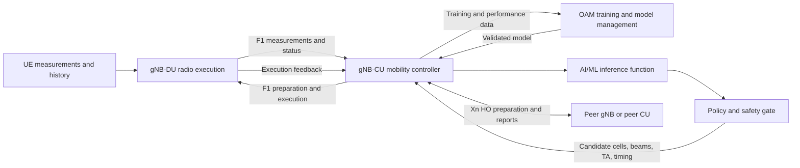
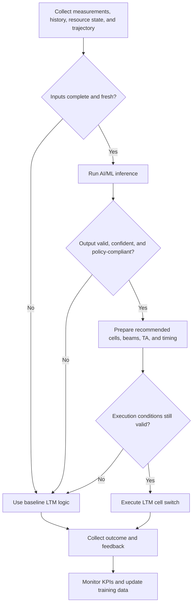
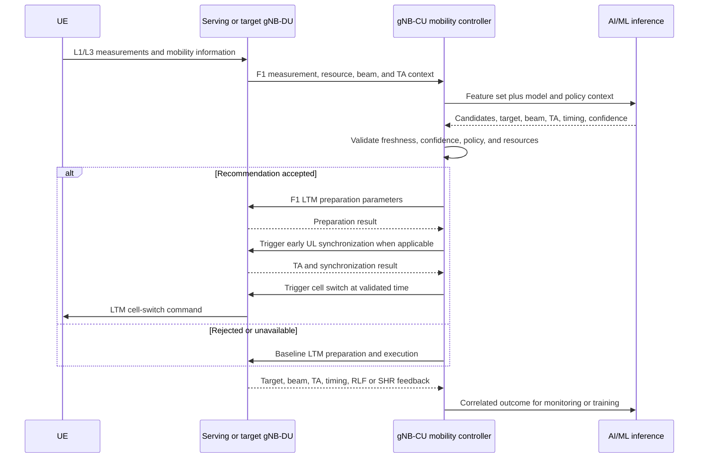
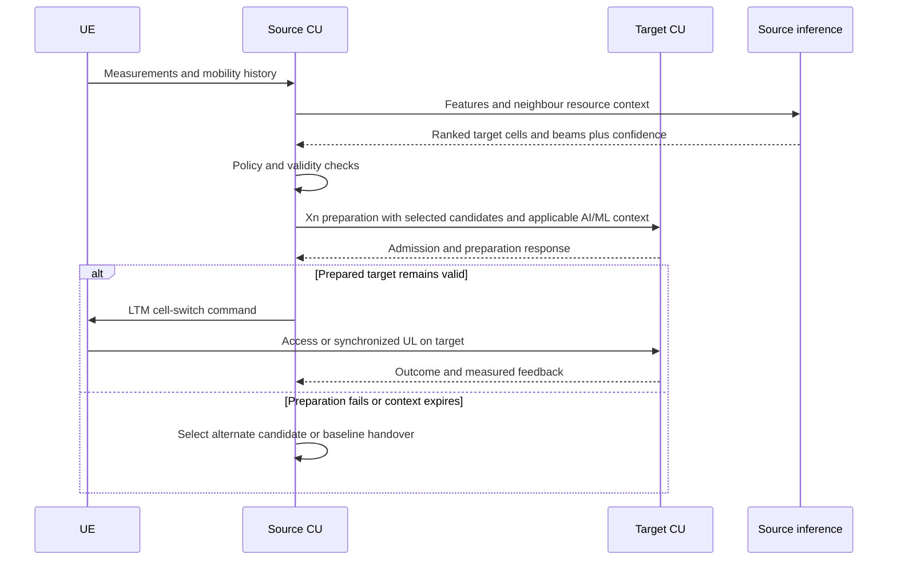
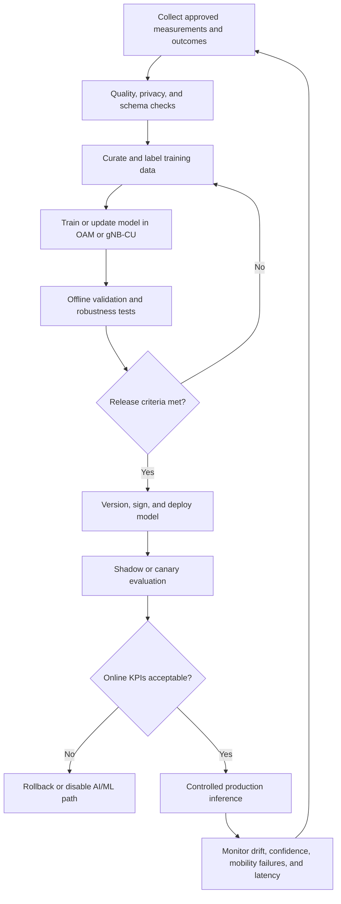

# AI/ML-Assisted Mobility Design for NG-RAN (LTM Handover - Intra-CU/gNB and Inter-CU/gNB improvement)

**Source baseline:** 3GPP TR 38.745 V20.0.0 (Release 20, March 2026)

**Status:** This is an engineering proposal based on a study report, not a 3GPP specification or an implementation requirement. TR 38.745 recommends the use cases for Rel-20 normative work; its candidate solutions and information are not, by themselves, normative. Exact procedures, information elements, timers, fallback rules, and model-management requirements remain subject to specification.

## Document Purpose

This Markdown document summarizes the relevant TR 38.745 study material and proposes an experimental design flow for multi-hop UE trajectory, AI/ML-assisted intra-CU L1/L2 Triggered Mobility (LTM), and AI/ML-assisted inter-CU LTM.

It also now captures a focused reference note for the MAC specification so the repository has an explicit, readable summary of MAC CE structure alongside the existing mobility-study material.

## Table of Contents

1. Scope
2. References
3. Terms, Symbols, and Abbreviations
4. System Context and Design Principles
5. Multi-hop UE Trajectory
6. AI/ML-Assisted Intra-CU LTM
7. AI/ML-Assisted Inter-CU LTM
8. End-to-End AI/ML Lifecycle
9. Interface and Data Design
10. Resilience, Security, and Observability
11. Verification and Validation
12. Normative Work Items and Implementation Checklist
13. MAC CE Cell Switch Command Reference
14. Conclusion
15. Annex A — Change History

## 1. Scope

The source studies three Release 20 AI/ML mobility use cases:

- Multi-hop UE trajectory prediction and collection.
- AI/ML-assisted intra-CU LTM using L3 and L1 measurements with inference in the gNB-CU.
- AI/ML-assisted inter-CU LTM, including candidate-cell selection and Xn-related impacts.

This design preserves existing LTM control procedures and introduces AI/ML as an advisory optimization function. Deterministic policy, protocol validation, admission control, and fallback logic remain authoritative.

## 2. References

1. [3GPP TR 38.745 V20.0.0, *Study on Artificial Intelligence (AI)/Machine Learning (ML) for NG-RAN Phase 3*, Release 20 (March 2026)](../standards/references/38745-k00.pdf).
2. 3GPP TR 21.905, *Vocabulary for 3GPP Specifications*.
3. 3GPP TS 38.300, *NR; NR and NG-RAN Overall Description*.
4. 3GPP TS 38.401, *NG-RAN; Architecture Description*.
5. [38321-j40_MAC Spec.pdf](../standards/references/38321-j40_MAC%20Spec.pdf).

References are specific or non-specific as defined by 3GPP drafting practice. A non-specific 3GPP reference resolves to the latest version in the same Release as this design baseline.

## 3. Terms, Symbols, and Abbreviations

The source adds no formal terms or symbols. The following working abbreviations are used:

| Abbreviation | Meaning |
|---|---|
| AI/ML | Artificial Intelligence / Machine Learning |
| CU | Central Unit |
| DU | Distributed Unit |
| gNB | Next Generation NodeB |
| HO | Handover |
| LTM | L1/L2 Triggered Mobility |
| OAM | Operations, Administration, and Maintenance |
| RLF | Radio Link Failure |
| RSRP | Reference Signal Received Power |
| RSRQ | Reference Signal Received Quality |
| SHR | Successful Handover Report |
| SINR | Signal-to-Interference-plus-Noise Ratio |
| SON | Self-Organizing Network |
| SSB | Synchronization Signal Block |
| TA | Timing Advance |
| UE | User Equipment |
| UL | Uplink |
| Xn | Interface between NG-RAN nodes |

## 4. System Context and Design Principles

### 4.1 Functional Architecture

### 4.2 Design Principles

1. **Advisory intelligence:** AI/ML recommendations do not bypass standardized mobility checks.
2. **Safe fallback:** invalid, stale, low-confidence, or unavailable inference falls back to conventional LTM logic.
3. **Freshness-bound inputs:** every measurement, trajectory, resource state, model output, and TA value carries time context and validity.
4. **Interface minimization:** transfer only information required for the selected use case over F1 or Xn.
5. **Closed-loop learning:** outcomes are correlated with the model version and inference decision that influenced them.
6. **Interoperability:** unsupported AI/ML information must not prevent baseline mobility procedures.
7. **Traceability:** model, input snapshot, decision, policy override, execution, and outcome are auditable.

### 4.3 High-Level Decision Flow

## 5. Multi-hop UE Trajectory

### 5.1 Use Case

Release 18 cell-based trajectory information is limited to the first-hop target NG-RAN node. Release 20 study work extends this concept across gNBs. A predicted trajectory is an ordered list of cells with expected residence times.

### 5.2 Training and Inference Placement

Training and inference placements considered by the study are:

- Training in OAM; inference in the gNB.
- Training and inference in the gNB.
- For CU-DU split: training in OAM; inference in the gNB-CU.
- For CU-DU split: training and inference in the gNB-CU.

### 5.3 Inputs

From the UE:

- Serving- and neighbour-cell measurements such as RSRP, RSRQ, and SINR.
- Mobility History Information.

From neighbouring RAN nodes:

- UE History Information.

From the local node:

- Previously measured multi-hop UE trajectory.

### 5.4 Output and Feedback

Output:

- Ordered predicted cells across gNBs.
- Expected UE residence time per predicted cell.

Feedback:

- Measured trajectory collected at every visited gNB.

### 5.5 Xn Design Impact

The initial source gNB includes the predicted multi-hop trajectory in Handover Preparation toward a target gNB. Information supporting trajectory collection is propagated to subsequent gNBs.

### 5.6 Processing Rules

1. Assign a trajectory identifier and creation time.
2. Bind predictions to UE context without exposing unnecessary identity information.
3. Maintain chronological cell order and optional dwell-time confidence.
4. Remove expired hops before forwarding.
5. Detect loops, invalid cells, topology conflicts, and stale predictions.
6. Correlate measured hops with the original prediction for model evaluation.
7. Continue normal handover when trajectory information is absent or rejected.

## 6. AI/ML-Assisted Intra-CU LTM

### 6.1 Use Case

LTM is defined in TS 38.300 and intra-CU LTM in TS 38.401. AI/ML is studied to improve UE and network performance, optimize resource allocation, and reduce mobility failures.

### 6.2 Training and Inference Placement

- Training in OAM and inference in the gNB-CU; or
- Training and inference in the gNB-CU.

### 6.3 Inputs

Local-node inputs:

- L3 measurement results.
- UE history information.
- Measured or predicted radio-resource status per cell or SSB area.
- Measured or predicted cell-based UE trajectory.
- Historical candidate LTM cell and beam lists.
- Measured TA values.

UE-originated inputs:

- UE measurement reports.
- Mobility history information.

### 6.4 Outputs

- Candidate cells and beams for LTM HO preparation.
- Target cells and beams for the cell-switch command.
- Cells and beams for early UL synchronization.
- TA values for early UL synchronization.
- Cell-switch trigger timing for L3-measurement-based LTM.
- Early-UL-synchronization trigger timing for L3-measurement-based LTM.
- Best beam of the first cell in the predicted cell-based trajectory.
- TA validity time.

**Open normative point:** applicability of predicted TA validity time to measured and/or predicted TA remains to be assessed.

### 6.5 Feedback

- Actual LTM target cell and beam.
- Measured TA values.
- SON reports, including RLF and SHR where applicable.
- Cell-switch execution time.
- Early-UL-synchronization time.

### 6.6 Intra-CU Preparation and Execution Flow

### 6.7 F1 Impact

F1 is expected to support applicable transfer of the inputs, outputs, and feedback listed above. A normative design should define capability negotiation, identifiers, timestamps, confidence, validity, and error handling.

## 7. AI/ML-Assisted Inter-CU LTM

### 7.1 Use Case

Inter-CU LTM is defined in TS 38.300. AI/ML may optimize the procedure, particularly candidate-cell selection.

### 7.2 Design Baseline

The intra-CU inputs, outputs, feedback, validation, and fallback principles should be reused where applicable. Information that crosses CU or gNB boundaries requires corresponding Xn support.

### 7.3 Inter-CU Controls

- Negotiate support before sending optional AI/ML information.
- Limit disclosed UE history and model-derived context.
- Validate target topology, capacity, beam availability, and timing independently.
- Define handling for partial candidate-list acceptance.
- Prevent source and target decisions from using incompatible validity assumptions.
- Correlate Xn feedback with the initiating inference and model version.

## 8. End-to-End AI/ML Lifecycle

### 8.1 Model-Governance Requirements

- Immutable model identifier and version.
- Documented feature schema and preprocessing version.
- Compatibility declaration for software and interface versions.
- Signed artifact and controlled deployment authorization.
- Performance thresholds by mobility scenario.
- Drift, bias, calibration, and confidence monitoring.
- Rollback to the last accepted model.
- Retention policy for training and inference records.

## 9. Interface and Data Design

### 9.1 Common Information Model

| Field | Purpose |
|---|---|
| UE context reference | Correlates mobility information without unnecessary identity exposure |
| Decision or trajectory ID | Correlates preparation, execution, and feedback |
| Model ID and version | Makes decisions reproducible |
| Generation timestamp | Supports freshness validation |
| Validity duration | Prevents stale use |
| Source node and scope | Defines ownership and applicability |
| Candidate cells and beams | Carries ranked preparation choices |
| Confidence or score | Supports policy gating |
| Expected dwell time | Qualifies trajectory hops |
| TA value and source | Distinguishes measured from predicted TA |
| TA validity time | Bounds early synchronization use |
| Trigger-time recommendation | Supports cell switch or early UL synchronization |
| Outcome and cause | Supports monitoring and learning |

### 9.2 F1 Requirements

- CU-DU capability negotiation.
- Transfer of measurements, resource state, candidate lists, beam data, TA data, timing recommendations, and feedback where applicable.
- Clear request, response, rejection, partial-acceptance, and timeout behavior.
- Ordering and correlation across preparation and execution messages.

### 9.3 Xn Requirements

- Transfer predicted multi-hop trajectories during Handover Preparation.
- Initiate and deliver measured-trajectory reporting.
- Support applicable inter-CU LTM candidate and feedback information.
- Preserve backward compatibility when a peer does not support extensions.

## 10. Resilience, Security, and Observability

### 10.1 Failure and Fallback Rules

- Missing inputs: use baseline LTM.
- Inference timeout: do not delay the mobility deadline.
- Low confidence: reject or restrict the recommendation.
- Stale trajectory or TA: discard and reacquire.
- Target preparation failure: try a validated alternate or baseline procedure.
- Model or schema mismatch: disable the AI/ML path for the affected context.
- KPI degradation or drift: enter shadow mode or roll back.

### 10.2 Security and Privacy

- Authenticate and protect OAM, F1, and Xn exchanges according to applicable specifications.
- Apply least privilege to model deployment and data access.
- Minimize retained UE history and trajectory data.
- Protect model artifacts, feature pipelines, and inference logs from tampering.
- Detect anomalous measurements, poisoned feedback, and implausible predictions.

### 10.3 Operational Metrics

- LTM preparation success rate.
- Cell-switch success and interruption time.
- RLF and handover-failure rates.
- Early UL synchronization success and latency.
- Candidate-list precision and target acceptance.
- Predicted-versus-measured trajectory accuracy.
- TA prediction error and expiry rate.
- Inference latency, timeout rate, and fallback rate.
- Model confidence calibration and drift indicators.

## 11. Verification and Validation

### 11.1 Test Matrix

| Area | Minimum verification |
|---|---|
| Functional | Candidate ranking, target selection, beam selection, TA prediction, trigger timing |
| Interfaces | F1 and Xn capability negotiation, encoding, rejection, timeout, and backward compatibility |
| Mobility | Stationary, pedestrian, vehicular, dense urban, edge, and rapid topology-change cases |
| Robustness | Missing, delayed, contradictory, noisy, and adversarial inputs |
| Performance | Inference deadline, control-plane latency, scale, CPU, memory, and signaling load |
| Safety | Policy override, stale-output rejection, rollback, and baseline fallback |
| Learning | Prediction/outcome correlation, model drift, retraining, and version traceability |
| Security | Authorization, integrity, confidentiality, audit, and data-retention controls |

### 11.2 Acceptance Gates

1. No regression against baseline LTM under unsupported or failed AI/ML conditions.
2. AI/ML inference completes within the configured mobility decision budget.
3. F1 and Xn extensions interoperate with peers that ignore optional information.
4. Safety and policy gates reject invalid cells, beams, TA, and timing.
5. Target KPIs improve without unacceptable degradation in tail cases.
6. Every AI-influenced decision is traceable to inputs, policy, and model version.

## 12. Normative Work Items and Implementation Checklist

### 12.1 Normative Gaps

- Exact F1 and Xn procedures and information elements.
- Capability and feature negotiation.
- Candidate ranking semantics and confidence representation.
- Time reference, validity, expiry, and synchronization rules.
- Applicability of predicted TA validity to measured and predicted TA.
- Failure causes, partial acceptance, retries, and fallback.
- Data collection initiation, termination, correlation, and retention.
- Model lifecycle, deployment, monitoring, and rollback requirements.
- Security, privacy, charging, and operational impacts where applicable.

### 12.2 Implementation Checklist

- [ ] Select training and inference placement.
- [ ] Define feature ownership and freshness limits.
- [ ] Define F1 input, output, and feedback mappings.
- [ ] Define Xn trajectory and inter-CU mappings.
- [ ] Implement policy, confidence, and validity gates.
- [ ] Implement deterministic fallback.
- [ ] Add model and decision correlation identifiers.
- [ ] Add telemetry for mobility outcomes and inference behavior.
- [ ] Validate privacy and retention controls.
- [ ] Complete interoperability, robustness, and performance tests.
- [ ] Establish canary deployment and rollback.
- [ ] Document operational ownership and incident response.

## 13. MAC CE Cell Switch Command Reference

This repository also retains a MAC specification artifact. The PDF itself is not machine-readable in this workspace, so the section below is written as a **working note** for repository readers. It is intentionally non-normative and should be verified against the official 3GPP TS 38.321 text before being used for implementation.

### 13.1 What the Cell Switch MAC CE does

- It instructs the UE to perform a cell switch using MAC-layer control.
- The command is intended for short, time-sensitive control rather than payload delivery.
- In mobility terminology, the action is to change the active/specified cell context as instructed by the network.
- The exact encoding and the exact triggering behavior are governed by TS 38.321 and related release-specific procedures.

### 13.2 Working structure view

For repository documentation purposes, the Cell Switch MAC CE can be described as a compact control structure with:

- a CE identifier / subtype indicator,
- a cell selection field,
- and action semantics that tell the UE which configured cell context to switch to.

> Note: the exact bit allocation must be confirmed against the authoritative spec before any code is written.

### 13.3 Byte / bit layout reference table

The table below is a **documentation-friendly layout**, not a guarantee of the release-specific normative format.

| Octet | Bit range | Field | Meaning | UE action |
|---|---|---|---|---|
| 1 | 7..4 | MAC CE type / command discriminator | Identifies the control element as a cell-switch-related MAC CE | Parse as a cell-switch command and continue field decoding |
| 1 | 3..0 | Cell index / target cell selector | Selects the configured cell context to be activated | Switch to the indicated cell context |

### 13.4 Field-level notes

- **MAC CE type / discriminator:** tells the UE which MAC control command is present.
- **Cell index / target selector:** maps the command to a configured cell context.
- **Reserved bits:** if present in a specific release or variant, they are typically alignment or future-extension bits and must be handled per spec.
- **Length and packing:** if the command is extended in a specific release, any length prefix or packed field layout is release-specific and must follow the standard text exactly.

### 13.5 Action semantics

When the UE receives the Cell Switch MAC CE:

1. It validates the CE type and format.
2. It interprets the cell selector using its configured cell mapping.
3. It updates the active cell context as instructed.
4. It applies any associated timing / synchronization behavior required by the underlying mobility procedure.
5. If the command is malformed, unsupported, or inconsistent with configured context, the UE should follow the spec-defined error/fallback behavior.

### 13.6 Repository usage note

For this repository, the most useful takeaway is architectural rather than implementation-specific:

- MAC control should remain compact and deterministic.
- Any mobility-related control over MAC must be deadline-safe.
- If future AI-assisted logic ever influences MAC control, it should still map to a bounded, validated command path with clear fallback.

## 14. Conclusion

RAN3 recommends __multi-hop UE trajectory__, __AI/ML-assisted intra-CU LTM__, and __AI/ML-assisted inter-CU LTM__ for __Release 20__ normative work (TR 38.745, clause 5). The report studies candidate solutions and impacts; it does not itself define a deployed implementation.

The added MAC CE reference section above is intended to make the repository easier to navigate when the MAC-related material is reviewed alongside the mobility design.

## 15. Annex A — Change History

| Date | Meeting | TDoc | Subject / Comment | New version |
|---|---|---|---|---|
| 2025-10 | RAN3#129-bis | R3-256546 | Skeleton for TR 38.745 | 0.0.0 |
| 2025-10 | RAN3#129-bis | R3-257331 | Included agreed text proposals R3-257329 and R3-257031 | 0.0.1 |
| 2025-10 | RAN3#129-bis | R3-257331 | Version update | 0.1.0 |
| 2025-11 | RAN3#130 | R3-258086 | Submitted for endorsement | 0.1.1 |
| 2025-11 | RAN3#130 | R3-258878 | Included agreed proposals R3-258864, R3-258865, and R3-258866 | 0.2.0 |
| 2025-12 | RAN#110 | RP-253139 | Submitted for approval | 1.0.0 |
| 2026-02 | RAN3#131 | R3-260027 | Submitted for endorsement | 1.1.0 |
| 2026-02 | RAN3#131 | R3-260821 | Included agreed proposals R3-260670, R3-260724, R3-260806, and R3-260807 | 1.2.0 |
| 2026-03 | RAN#111 | RP-260263 | Submitted for approval | 2.0.0 |
| 2026-03 | RAN#111 | — | Approved by RAN plenary | 20.0.0 |

## 16. References

* https://www.sharetechnote.com/html/5G/5G_LTM.html
* https://www.ericsson.com/en/blog/2024/8/5g-advanced-handover-triggered-mobility
* https://www.ericsson.com/en/blog/2025/12/one-step-closer-to-zero-latency-handovers-on-the-path-to-6g
* https://ieeexplore.ieee.org/document/10744020 (Rel18)
* https://ieeexplore.ieee.org/document/10817289 (Baseline for 6G)
